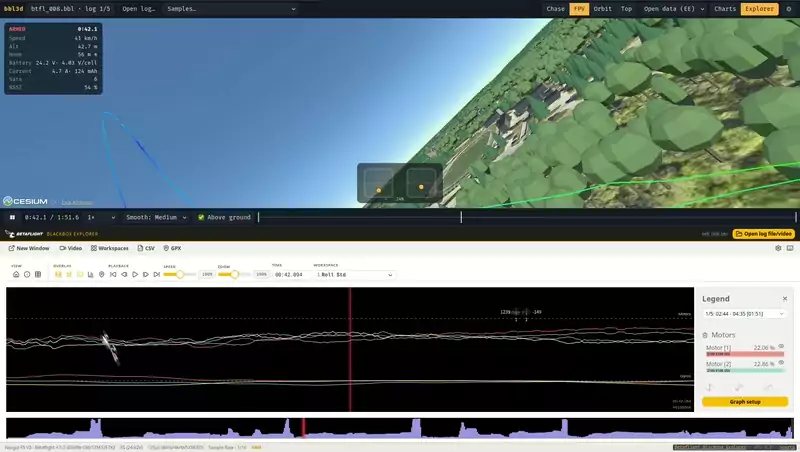

<div align="center">

# bbl3d

### Fly your Betaflight blackbox logs again, in 3D

Drop in a `.bbl` and watch the flight replayed over a 3D map,
with chase and FPV cameras, your sticks, an OSD-style HUD, and every logged
field one click away.

<p>
  <a href="https://bbl3d.0s.is"></a>
</p>
<p>
  
  
  
  
  
</p>

<a href="docs/demo.mp4"></a>

<sub>A real 5" flight replayed in FPV over Estonian open data with 3D trees, with Betaflight's
Blackbox Explorer synced underneath. <a href="docs/demo.mp4">Watch the full-quality video</a>.</sub>

<br><br>

**[Try it at bbl3d.0s.is →](https://bbl3d.0s.is)**<br>
<sub>No install and no account. Pick a sample flight or drop your own log.</sub>

</div>

---

## Features

<table>
<tr>
<td width="50%" valign="top">

### 🌍 Real 3D world
Google Photorealistic 3D Tiles: textured buildings, trees and terrain almost
everywhere. Uses a free Cesium ion token; [setup takes two minutes](#-google-3d-setup-free-cesium-ion-token).
There's also a keyless open-data map: satellite imagery on terrain, plus
Estonian Land Board buildings and single trees.

</td>
<td width="50%" valign="top">

### 🎥 Four cameras
**Chase**, **FPV** (adjustable camera uptilt and FOV), **Orbit** and
**Top-down**. Switch with <kbd>1</kbd>–<kbd>4</kbd> at any point in the replay.

</td>
</tr>
<tr>
<td valign="top">

### 🕹️ Sticks and HUD
Live gimbals from `rcCommand` (Mode 1 or 2) and an OSD-style readout: speed,
altitude, distance and arrow home, battery V / A / mAh / cell voltage, sats,
RSSI, armed state and active flight modes.

</td>
<td valign="top">

### 📈 Charts for any field
Stacked, cursor-synced charts with presets: setpoint vs gyro, motors, eRPM,
PID terms, battery, RC. Drag to zoom and click to seek.

</td>
</tr>
<tr>
<td valign="top">

### 🔬 Blackbox Explorer built in
Betaflight's own [Blackbox Explorer](https://github.com/betaflight/blackbox-log-viewer)
opens in the bottom panel (<kbd>e</kbd>) with the same log. Seeking in either
the Explorer or the 3D replay moves the other.

</td>
<td valign="top">

### 🧭 Accurate attitude
A GPS-aided attitude filter keeps the quad's bank angle correct in sustained
turns, where a plain gyro and accelerometer estimate drifts. Heading comes from
GPS course, so you don't need a magnetometer.

</td>
</tr>
<tr>
<td valign="top">

### 🚦 Timeline that tells the story
Flight-mode bands (Angle, Horizon, GPS Rescue, Turtle, …), disarm reasons and
events on the scrubber. Logs that end abruptly are flagged as cut off. Mode
names are decoded correctly for each firmware version.

</td>
<td valign="top">

### 🪶 Smooth and grounded
Adjustable smoothing for the path and attitude. Optional above-ground
correction lifts the path wherever baro drift would put it underground.

</td>
</tr>
<tr>
<td valign="top">

### 🔒 Private by design
Logs are parsed in a Web Worker inside your browser and never leave your
machine. Only map tiles are downloaded.

</td>
<td valign="top">

### ✈️ Sample flights
Freestyle lines around the Eiffel Tower and the Golden Gate Bridge are one
click away, so you can try it without a log.

</td>
</tr>
</table>

## 🗺️ Google 3D setup (free Cesium ion token)

The photorealistic map is served through [Cesium ion](https://cesium.com/platform/cesium-ion/).
The free **Community** plan covers it, and you don't need a credit card.

1. **Sign up** at [ion.cesium.com/signup](https://ion.cesium.com/signup) and pick the free Community plan.
2. **Check your assets.** Open **My Assets** and make sure **Google Photorealistic 3D Tiles**
   and **Cesium World Terrain** are listed. If either is missing, add it from the **Asset Depot**.
3. **Copy a token.** Go to **Access Tokens** and copy the *Default* token.
   Optionally, create a dedicated token instead: give it the `assets:read` scope, select those two
   assets, and set **Allowed URLs** to `https://bbl3d.0s.is` so it can't be used anywhere else.
4. **Paste it into bbl3d.** In [bbl3d](https://bbl3d.0s.is), open **⚙ Settings**, paste the
   token and set **Map** to **Google 3D**.

The token is stored only in your browser's local storage. The Community plan is for personal,
non-commercial use and includes roughly 1,000 Google 3D tileset loads a month, which is plenty
for replaying your own flights.

> [!TIP]
> No token? The **Open data** map works without one: satellite imagery on terrain everywhere,
> plus 3D buildings and trees in Estonia.

## 🚀 Using it

1. Open **[bbl3d.0s.is](https://bbl3d.0s.is)**.
2. Drop a `.bbl` / `.bfl` file from your flight controller's flash or SD card, or pick a sample.
3. If the file holds several logs, pick one. Each card shows its duration, top speed and distance.
4. Press <kbd>Space</kbd> and fly.

<details>
<summary><b>Keyboard shortcuts</b></summary>
<br>

| Key | Action |
| --- | --- |
| <kbd>Space</kbd> | Play / pause |
| <kbd>←</kbd> <kbd>→</kbd> | Seek ±5 s (with <kbd>Shift</kbd>: ±1 s) |
| <kbd>,</kbd> <kbd>.</kbd> | Step one log frame |
| <kbd>1</kbd> <kbd>2</kbd> <kbd>3</kbd> <kbd>4</kbd> | Chase / FPV / Orbit / Top camera |
| <kbd>c</kbd> | Charts panel |
| <kbd>e</kbd> | Blackbox Explorer panel |

In charts: drag to zoom, double-click to reset, click to seek.

</details>

**What a log needs:** GPS (a GPS module logged to blackbox) for the flight path. Baro improves the
altitude. Betaflight 4.x, 2025.12 and 2026.x logs are supported.

---

## 🛠️ Running your own copy

You don't need to: [bbl3d.0s.is](https://bbl3d.0s.is) is the same app, and your logs stay
in your browser there too. If you want to hack on it or host it yourself, read on.

<details>
<summary><b>Develop locally</b></summary>
<br>

Needs Node 20.19+ (22 LTS recommended; `nvm use` picks it up from `.nvmrc`).

```bash
npm install
npm run dev        # http://localhost:5173
```

</details>

<details>
<summary><b>Self-host</b> (it's a static site)</summary>
<br>

`npm run build` writes a fully static site to `dist/`. Serve it from any static host or
sub-path. For example, with Caddy:

```caddy
bbl3d.example.com {
	root * /srv/bbl3d          # contents of dist/
	encode zstd gzip
	file_server

	@hashed path /assets/* /blackbox-viewer/assets/*
	header @hashed Cache-Control "public, max-age=31536000, immutable"
}
```

The Explorer is a same-origin iframe. If you set `X-Frame-Options` or `frame-ancestors`, use
`SAMEORIGIN` / `'self'`.

</details>

<details>
<summary><b>Estonian 3D buildings and trees</b> (open-data map)</summary>
<br>

Land Board LOD2 buildings and single trees are converted into 3D Tiles locally and included
in the build:

```bash
npm run tiles:ee -- --area Tallinn      # needs Docker (GDAL) and ~3 min
```

`--area` is a municipality as named on the geoportal's
[Download 3D data](https://geoportaal.maaamet.ee/eng/Download-3D-data-p837.html) page
(`Tallinn`, `Tartu_linn`, `Saue_vald`, …). `--only buildings|trees` builds one layer. Output goes
to `public/tiles/` and isn't committed; Tallinn is about 300 MB.

</details>

<details>
<summary><b>Sample flights</b></summary>
<br>

The samples in `public/samples/` are synthetic. Each is generated from a planned path
(`scripts/samples/`): thrust direction gives the attitude, and the attitude gives the gyro,
accelerometer, motor, battery, GPS and baro data. The result is written as a real
Betaflight 4.5-style `.bbl`. Paths were checked against OpenStreetMap structure positions and
the Copernicus GLO-30 surface model. Regenerate them with `npm run samples` (needs Docker for
GDAL).

</details>

<details>
<summary><b>Blackbox Explorer build</b></summary>
<br>

`public/blackbox-viewer/` is Betaflight's viewer built from a pinned upstream commit with a
small embedding patch (`scripts/blackbox-viewer/bbl3d-embed.patch`). The patch adds a
postMessage bridge, uses relative asset paths and drops the service worker. The build is
committed; rebuild it with `npm run viewer` (needs Node 24).

</details>

<details>
<summary><b>Tests</b></summary>
<br>

```bash
npm test           # unit tests against real logs in fixtures/ (git-ignored)
npm run build
docker run --rm --network host -v "$PWD:/app" -w /app \
  mcr.microsoft.com/playwright:v1.58.0-noble node e2e/smoke.mjs
```

Tests skip when the fixture logs are missing. `fixtures/decoded/*.csv` are
`blackbox_decode --merge-gps` outputs from
[blackbox-tools](https://github.com/betaflight/blackbox-tools). To test a deployed copy, set
`E2E_URL=https://…` for the e2e run.

</details>

## 🧠 How the flight is reconstructed

- **Parsing** uses the official [blackbox-log-viewer](https://github.com/betaflight/blackbox-log-viewer)
  parser, vendored unchanged in `src/parser/vendor/` (see `UPSTREAM.md`) and run in a Web Worker.
- **Flight modes**: since Betaflight 4.0, `flightModeFlags` holds the mode switches
  (`rcModeActivationMask`), and their bit order changed in 2025.12 and 2026.6.
  `src/flight/modes.ts` decodes it per firmware version; the stock viewer mislabels these for 4.x
  logs.
- **Position**: GPS fixes are interpolated between updates. Height is the baro altitude above the
  start point, added to the ground height at home.
- **Attitude**: a GPS-aided complementary filter (`src/flight/attitude.ts`). A multirotor's
  accelerometer mostly measures thrust, so a plain gyro and accelerometer estimate drifts toward
  level in sustained turns. This filter instead compares the measured specific force with the
  acceleration seen by GPS and baro, and pulls heading toward the GPS course.

## 📜 Credits and licence

bbl3d is **GPL-3.0**, because it includes Betaflight's GPL-3.0 blackbox parser and Blackbox
Explorer. Thanks to the [Betaflight](https://github.com/betaflight) project and contributors.

Map data comes from:
- Google, through [Cesium ion](https://cesium.com/platform/cesium-ion/)
- Esri, Maxar and Earthstar Geographics
- Mapzen / Tilezen terrain on AWS Open Data
- [Maa- ja Ruumiamet](https://maaruum.ee) (Estonian Land and Spatial Development Board) open
  data: orthophoto, buildings and trees

<div align="center"><br><sub>Built for pilots who want to see what actually happened up there. 🛸</sub></div>
